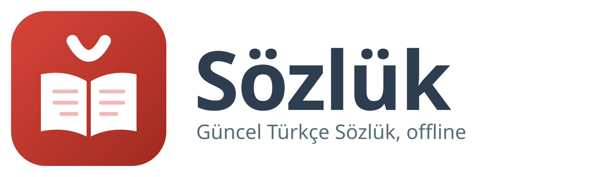

<p align="center"></p>

# Sözlük (tdk-sozluk-rs)

[Türkçe](README.md) · **English**

The TDK Güncel Türkçe Sözlük on the desktop, offline: look a word up, check a subtitle line
against it, keep the words you need pinned. Drawn with
[markdown-shared-rs](https://github.com/Kaan88/markdown-shared-rs), pinned at `ffffe3e`, so it
looks and moves like mdview and mdedit. The interface is in Turkish by default; English is one
click away on the Settings tab.

## Install

`Sozluk-Setup-<version>.exe` from [Releases](https://github.com/Kaan88/tdk-sozluk-rs/releases/latest):
per user, no administrator rights, Windows 10 1809 or later. Also in
[mdhub](https://github.com/Kaan88/mdhub).

## What it does

- **Look up.** All 81,017 headwords are built into the program, so search works with no files
  and no network. Typing without Turkish letters works: `kagit` finds `kâğıt`. Spelling variants
  are shown (`yeraltı` / `yer altı`, `hala` / `hâlâ`). A full entry shows meanings with their
  word types, the first example and its author, the origin, compounds and idioms; cross
  references (`► nişanlı`) open their target.
- **Check.** Type, paste, copy (with "Check what I copy" on) or drop an `.srt`: every word is
  looked up, by its stem too (`kâğıdı` → `kâğıt`, `görünüyordu` → `görünmek`). TDK spellings are
  fixed in one click ("Fix 3 and copy"); pairs where both forms are TDK words are left to you
  with both meanings; unknown words can be taken as names from then on.
- **For subtitles.** The synonyms TDK lists inside a word's meanings, with their letter count
  and the difference against the open word, for a CPS cut.
- **Pinned and recent** words, kept between runs.
- **Settings.** Theme, backdrop and language (Türkçe or English); where the full entries come
  from and how far the download is.

## The look

- **Theme in three stages:** System, Light (default), Dark. The thumb slides; every colour of
  the window glides to the new theme (360 ms, Fluent's point-to-point curve) instead of
  switching in one frame. System follows Windows' own switch live.
- **Mica and Acrylic** (Windows 11) behind the title row, the bars, the status strip and the
  full window's side panes; the reading area stays solid. Off (default), Mica or Acrylic on the
  Settings tab or with Ctrl+B. The frosted chrome follows the theme while it glides. Shown only
  while the window is active and never in high contrast (the toolkit's rule).
- **Compact and Full:** a 420 px window to keep beside a subtitle editor (with always on top),
  or a three-pane window with matches, pinned and recent on the left and the subtitle tools on
  the right. One click or Ctrl+M. The window opens where it was left; the Full view also keeps
  its size (the compact one is always 420 × 660).
- **Motion:** pages fade and slide in, the tab underline and the list selection ride a spring,
  hovers fade, the search field's accent line grows from the middle, toasts rise and fall.
  Windows' "Animation effects" off turns them into cuts (the toolkit's policy).

## Colours

TDK's own, from sozluk.gov.tr's stylesheet: red `#c62828`, paper `#f7f5ec`, slate `#2c3e50`,
sienna `#a0522d` for word types; in the dark, navy `#1a1a2e`, cards `#24243e` and gold
`#daa520`. Two shades are moved within their family to reach 4.5:1 for small text (see
`src/theme.rs`).

## Data

- Headwords: `data/gts-headwords.txt` (sozluk.gov.tr/data/autocomplete.json, 2026-11-27).
- Full entries: the `gts.sqlite` of the crawl in `tools/tdk-crawl.py` (by default
  `data/gts.sqlite`, not committed), opened read-only, so it can be read while the crawl still
  writes. Found at `$SOZLUK_DB`, next to `sozluk.exe`, or in `%LOCALAPPDATA%\sozluk`. The crawl
  can be split across machines (`--shard i/n`) and the parts joined with `--merge`.
- Offline dictionary: Sözlük downloads the newest `gts.sqlite` from the crawl's server itself
  (once a day from Settings, or with "Check now"). A download whose checksum or SQLite check
  fails is not used; the file before stays as `gts.sqlite.prev`.
- Missing entries are asked from sozluk.gov.tr, one at a time, and kept in
  `%LOCALAPPDATA%\sozluk\live-cache.sqlite`. Off with one switch on the Settings tab. A 429
  (rate limit) pauses live lookups for 90 s.

## Keys

| Key | Does |
|---|---|
| Ctrl+K, Ctrl+L, F3 | Search |
| Up, Down, Enter, Esc | Pick a match, open it, close the list or clear |
| Typing anywhere | Starts a search |
| Ctrl+1 … Ctrl+4 | Look up, Check, Pinned, Settings |
| Alt+Left, Alt+Right, mouse back/forward | Back, forward |
| Ctrl+D | Pin or unpin the word |
| Ctrl+Shift+C | Copy the word |
| Ctrl+Shift+V | Check the clipboard |
| Ctrl+Enter (Check) | Fix all and copy |
| Ctrl+T | Next theme |
| Ctrl+M | Compact or Full |
| Ctrl+B | Next backdrop (Off, Mica, Acrylic) |

## Icon

`assets/logo.svg` and `assets/logo-wordmark.svg`; `tools/make_icon.py` draws the same tile into
`assets/icon.ico` (in the exe, by `build.rs`), the PNGs and the raw pixels of the window and
taskbar icons. The tile is TDK's red; over the open book is the breve of ğ.

## Build

```sh
cargo run --release
cargo test
```

`--demo` starts without reading or writing the settings; with it, `--word W`, `--tab check`,
`--check "text\nmore"`, `--search q`, `--theme light|dark|system`, `--lang tr|en`, `--full`
set the first screen (for screenshots). `--demo-switch` flips the theme 1.5 s after start.

## License

MIT, see [LICENSE](LICENSE). The headwords and the entries are TDK's (sozluk.gov.tr).
