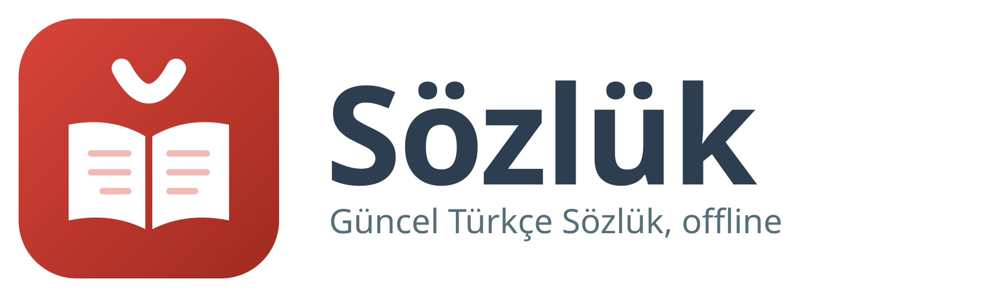

<p align="center"></p>

# Sözlük (tdk-sozluk-rs)

**Türkçe** · [English](README.en.md)

TDK Güncel Türkçe Sözlük masaüstünde ve çevrim dışı: sözcük arayın, altyazı satırlarını
sözlüğe göre denetleyin, gerek duyduğunuz sözcükleri sabitleyin.
[markdown-shared-rs](https://github.com/Kaan88/markdown-shared-rs) ile çizilir (`ffffe3e`
sürümüne sabit); bu yüzden mdview ve mdedit gibi görünür ve devinir. Arayüz öntanımlı olarak
Türkçedir; İngilizceye Ayarlar sekmesinden tek tıkla geçilir.

## Kurulum

[Sürümler](https://github.com/Kaan88/tdk-sozluk-rs/releases/latest) sayfasından
`Sozluk-Setup-<sürüm>.exe`: kullanıcıya kurulur, yönetici izni istemez, Windows 10 1809 ve
sonrası. [mdhub](https://github.com/Kaan88/mdhub) içinde de var.

## Ne yapar

- **Ara.** 81.017 maddenin tümü programın içindedir; arama dosyasız ve ağsız çalışır. Türkçe
  harfler olmadan yazmak da olur: `kagit` yazınca `kâğıt` bulunur. Yazım farkları gösterilir
  (`yeraltı` / `yer altı`, `hala` / `hâlâ`). Tam madde; anlamları sözcük türleriyle, ilk örneği
  ve yazarını, kökeni, birleşik sözcükleri ve deyimleri gösterir. Göndermeler (`► nişanlı`)
  tıklanınca hedefini açar.
- **Denetle.** Yazın, yapıştırın, kopyalayın ("Kopyaladığımı denetle" açıkken) ya da bir `.srt`
  bırakın: her sözcük, kökü de dahil sözlükte aranır (`kâğıdı` → `kâğıt`, `görünüyordu` →
  `görünmek`). TDK yazımları tek tıkla düzeltilir ("Düzelt (3) ve kopyala"). İki biçimi de
  sözlükte olan çiftler iki anlamıyla birlikte size bırakılır: "hala mı, hâlâ mı?". Bilinmeyen
  sözcükler bundan sonrası için özel ad sayılabilir.
- **Altyazı için.** TDK'nin bir sözcüğün anlamlarında verdiği eş anlamlılar, harf sayıları ve
  açık sözcüğe göre farklarıyla: CPS kısaltması için.
- **Sabitlenen ve son bakılan** sözcükler, kapatıp açınca da kalır.
- **Ayarlar.** Tema, arka plan ve dil (Türkçe ya da English); tam maddelerin nereden geldiği ve
  indirmenin ne kadar ilerlediği.

## Görünüm

- **Üç aşamalı tema:** Sistem, Açık (öntanımlı), Koyu. Seçici kayar; penceredeki her renk tek
  karede değişmek yerine yeni temaya süzülür (360 ms, Fluent'ın noktadan noktaya eğrisi).
  Sistem seçiliyken Windows'un kendi ayarı anında izlenir.
- **Mica ve Akrilik** (Windows 11): başlık satırının, çubukların, durum şeridinin ve geniş
  pencerenin yan bölmelerinin arkasında; okuma alanı düz kalır. Ayarlar sekmesinden ya da
  Ctrl+B ile Kapalı (öntanımlı), Mica ya da Akrilik. Buzlu kısımlar tema değişirken onunla
  birlikte süzülür. Yalnızca pencere etkinken ve yüksek karşıtlık kapalıyken görünür (araç
  takımının kuralı).
- **Dar ve Geniş:** altyazı düzenleyicisinin yanında durmak için 420 px'lik bir pencere (hep
  üstte seçeneğiyle) ya da solda eşleşmeler, sabitlenenler ve son bakılanlar, sağda altyazı
  araçları olan üç bölmeli bir pencere. Tek tık ya da Ctrl+M. Pencere bırakıldığı yerde açılır;
  geniş görünüm boyutunu da hatırlar (dar görünüm hep 420 × 660).
- **Devinim:** sayfalar solarak ve kayarak gelir, sekme alt çizgisi ve liste seçimi yayla
  kayar, üzerine gelince renkler yumuşakça değişir, arama kutusunun vurgu çizgisi ortadan
  büyür, bildirimler yükselip iner. Windows'ta "Animasyon efektleri" kapalıysa hepsi anında
  olur (araç takımının kuralı).

## Renkler

TDK'nin kendi renkleri, sozluk.gov.tr'nin stil dosyasından: kırmızı `#c62828`, kâğıt
`#f7f5ec`, arduvaz `#2c3e50`, sözcük türleri için toprak kızılı `#a0522d`; koyu temada lacivert
`#1a1a2e`, kartlar `#24243e` ve altın `#daa520`. Küçük yazıda 4,5:1 karşıtlığa ulaşmak için
iki ton kendi ailesi içinde kaydırıldı (bkz. `src/theme.rs`).

## Veri

- Madde listesi: `data/gts-headwords.txt` (sozluk.gov.tr/data/autocomplete.json, 2026-11-27).
- Tam maddeler: `tools/tdk-crawl.py` taramasının `gts.sqlite` dosyası (öntanımlı olarak
  `data/gts.sqlite`; depoya konmaz). Salt okunur açılır, bu yüzden tarama sürerken de
  okunabilir. `$SOZLUK_DB`'de, `sozluk.exe`'nin yanında ya da `%LOCALAPPDATA%\sozluk` içinde
  aranır. Tarama birkaç makineye bölünebilir (`--shard i/n`); parçalar `--merge` ile birleşir.
- Çevrimdışı sözlük: Sözlük, taramanın sunucusundaki en yeni `gts.sqlite` kopyasını
  kendisi indirir (Ayarlar'da günde bir kez ya da "Şimdi denetle" ile). İndirilen dosyanın
  sağlaması ve SQLite denetimi tutmazsa kullanılmaz; eski dosya `gts.sqlite.prev` olarak kalır.
- Eksik maddeler sozluk.gov.tr'ye teker teker sorulur ve
  `%LOCALAPPDATA%\sozluk\live-cache.sqlite` içinde saklanır. Ayarlar sekmesindeki tek
  düğmeyle kapatılır. 429 (hız sınırı) yanıtı canlı aramaları 90 sn durdurur.

## Tuşlar

| Tuş | İşlev |
|---|---|
| Ctrl+K, Ctrl+L, F3 | Ara |
| Yukarı, Aşağı, Enter, Esc | Eşleşme seç, aç, listeyi kapat ya da temizle |
| Herhangi bir yerde yazmak | Aramayı başlatır |
| Ctrl+1 … Ctrl+4 | Ara, Denetle, Sabitlenen, Ayarlar |
| Alt+Sol, Alt+Sağ, fare geri/ileri | Geri, ileri |
| Ctrl+D | Sözcüğü sabitle ya da sabitlemeyi kaldır |
| Ctrl+Shift+C | Sözcüğü kopyala |
| Ctrl+Shift+V | Panodakini denetle |
| Ctrl+Enter (Denetle) | Tümünü düzelt ve kopyala |
| Ctrl+T | Sonraki tema |
| Ctrl+M | Dar ya da Geniş |
| Ctrl+B | Sonraki arka plan (Kapalı, Mica, Akrilik) |

## Simge

`assets/logo.svg` ve `assets/logo-wordmark.svg`; `tools/make_icon.py` aynı kutucuğu
`assets/icon.ico` (exe'nin içine `build.rs` koyar), PNG'ler ve pencere ile görev çubuğu
simgelerinin ham pikselleri olarak çizer. Kutucuk TDK kırmızısıdır; açık kitabın üstünde ğ'nin
kısalık işareti durur.

## Derleme

```sh
cargo run --release
cargo test
```

`--demo` ayarları okumadan ve yazmadan başlatır; onunla birlikte `--word W`, `--tab check`,
`--check "metin\ndaha"`, `--search q`, `--theme light|dark|system`, `--lang tr|en`, `--full`
ilk ekranı belirler (ekran görüntüleri için). `--demo-switch` temayı açılıştan 1,5 sn sonra
değiştirir.

## Lisans

MIT, bkz. [LICENSE](LICENSE). Madde listesi ve maddeler TDK'nindir (sozluk.gov.tr).
